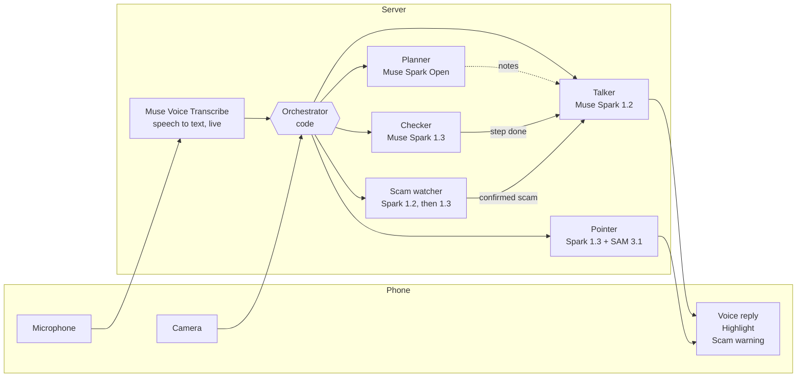
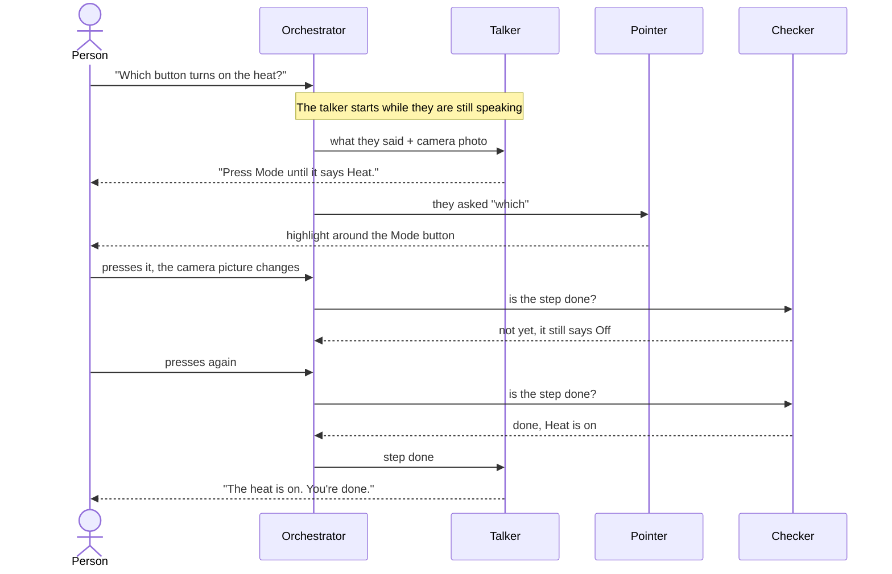

# TARS

**Point. Ask. Done.** TARS is a patient voice guide for anyone who finds technology hard: older people, people who can't read, and people who only speak their own language.

Point the phone camera at a screen or a physical device (a thermostat, a laptop, a letter, a medicine box) and talk. TARS answers by voice in your language, one step at a time. It highlights exactly where to press when you ask, checks through the camera that each step really worked, and warns you about scams before you fall for them.

**Try it:** [tars7--tars.us-east.modal.run](https://tars7--tars.us-east.modal.run) on a phone. Allow the microphone and camera, tap to start, and speak.

Built on Meta models only: Muse Spark 1.2, Muse Spark 1.3, Muse Spark Open, SAM 3.1 and Muse Voice Transcribe.

## What it helps with

| Ask | What TARS does |
|---|---|
| "What does this letter say?" | Reads an English letter or bill and explains it in your language, including what to do and by when |
| "Is this a scam?" | Turns the screen red and tells you calmly not to reply, pay or call |
| "It's cold, turn on the heat" | Guides you on the thermostat one step at a time, and says it's done only when it can see it |
| "Which tablet is this?" | Reads the name, dose and expiry printed on the box, without adding advice of its own |

## How it works

A small orchestrator, written in code, decides which agent runs and when. Each agent has one job, its own prompt, and a backup model. Only the talker speaks to the person.



### The agents

| Agent | Job | Model | Backup |
|---|---|---|---|
| Talker | The only voice. Decides what to say, one step at a time | Muse Spark 1.2 | Muse Spark Open |
| Checker | Looks at a sharp photo and a close-up: done, not done, or can't see | Muse Spark 1.3 | Muse Spark Open |
| Planner | Thinks the whole task through in the background and spots blockers | Muse Spark Open (Baseten) | Muse Spark 1.3 |
| Scam watcher | A quick look flags a scam, a careful look must agree before TARS warns | Spark 1.2, then Spark 1.3 | Muse Spark Open |
| Pointer | Finds the target in the photo, zooms in, and SAM 3.1 outlines it | Muse Spark 1.3 + SAM 3.1 | Muse Spark 1.2 |
| Translator | Puts the start screen in the phone's language | Muse Spark 1.2 | Muse Spark Open |

Speech to text is Muse Voice Transcribe, streamed live. Replies are spoken by the phone's own voice, so they start playing the moment the text arrives.

### One step, start to finish



### What makes it patient and trustworthy

- **One step at a time.** Every reply starts with the action itself, in about 15 words.
- **Proof before "done".** A step is finished only when the checker can see it. If a hand is in the way, TARS asks once, then trusts the answer.
- **Highlights only when asked.** "Where", "which" or "show me" brings up the highlight. Nothing pops up otherwise.
- **Listens while it talks.** If you start speaking, TARS stops. Its own voice and background sounds don't interrupt it.
- **Thinks ahead.** The talker starts on a reply during a short pause, so the answer is often ready when you finish.
- **Honest about limits.** It never claims a switch is on unless it can see it, and it says plainly when it can't speak a language.
- **Backups everywhere.** If a model is slow or fails, the agent's backup answers instead.

## Languages

TARS speaks and listens in the 25 languages Muse Voice Transcribe supports: Arabic, Bengali, Dutch, English, French, German, Hebrew, Hindi, Indonesian, Italian, Japanese, Kannada, Korean, Malay, Mandarin Chinese, Marathi, Polish, Portuguese, Spanish, Tagalog, Tamil, Telugu, Thai, Turkish and Vietnamese.

Say "speak Hindi" (or any of these) at any time to switch. If the phone has no voice for a language, TARS borrows one that reads the same alphabet.

## Run it yourself

You need Python 3.11, a Meta API key, and optionally a Baseten key for Muse Spark Open.

```bash
python -m venv .venv
.venv/Scripts/pip install -r requirements.txt
cp .env.example .env
.venv/Scripts/uvicorn server:app --port 8000
```

Fill in your keys in `.env`, then open http://localhost:8000. Phones need HTTPS for the camera and microphone, so use the hosted version (below) to test on a phone. On macOS or Linux, use `.venv/bin/` instead of `.venv/Scripts/`.

To host it on [Modal](https://modal.com) (one always-on container, keys read from `.env`):

```bash
modal deploy modal_app.py
```

## Files

| File | What it holds |
|---|---|
| `server.py` | The orchestrator: one session per phone, deciding which agent runs when |
| `agents.py` | Each agent's job, and the image helpers for close-ups |
| `prompts.py` | One prompt per agent |
| `models.py` | The models and each agent's backup chain |
| `voice.py` | The live Muse Voice Transcribe connection |
| `languages.py` | The 25 supported languages |
| `modal_app.py` | Hosting on Modal |
| `static/` | The phone app: camera, microphone, captions, highlight and voice |
